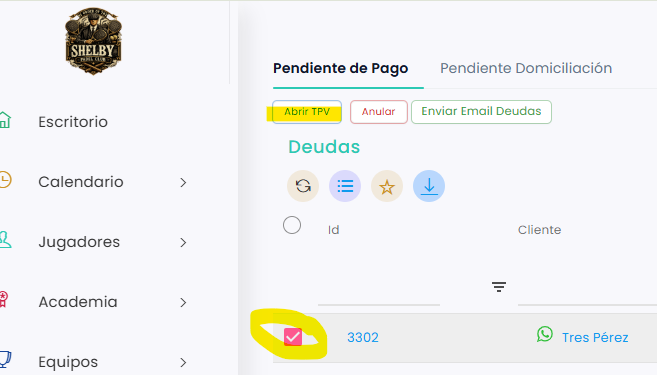

# Cómo cobrar una deuda

Desde **Ventas › Deudas** puedes cobrar lo que un cliente tiene pendiente: la deuda se abre en el TPV y se cobra como cualquier otra venta. Puedes cobrar una sola deuda o varias a la vez.

A continuación, se detallan los pasos a seguir:



### Acceso a Deudas

* Dirígete al menú lateral izquierdo y selecciona **Ventas**.
* En el desplegable, elige **Deudas**. Se abre la pestaña **Pendiente de Pago**.



### Seleccionar la deuda

* Localiza la deuda que quieres cobrar. Puedes usar los filtros de cada columna, por ejemplo **Cliente**.
* Marca la casilla de la izquierda de la deuda. Si quieres cobrar varias a la vez, márcalas todas.
*   Clica en **Abrir TPV**. 

    <figure><figcaption></figcaption></figure>



### Cobrar en el TPV

* Se abre el TPV con la deuda cargada.
* Si has marcado varias deudas, en el ticket de la derecha te aparece la opción de cargar todas las ventas, igual que cuando un jugador paga la parte de otro.
* Cobra la venta de la forma habitual.



Si tienes dudas con el cobro en el TPV, consulta [Cómo hacer una venta](https://taykus-help-center.gitbook.io/taykushelpcenter/home/tpv/tpv/ventas/como-hacer-una-venta).
