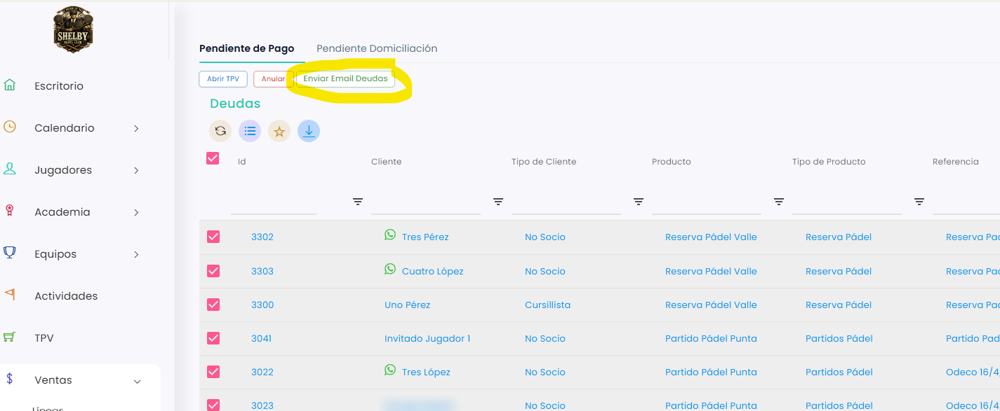

# Cómo enviar un email de deudas

Desde **Ventas › Deudas** puedes enviar un correo a los clientes que tienen pagos pendientes para recordárselo. Puedes enviarlo a uno, a varios o a todos a la vez.

A continuación, se detallan los pasos a seguir:



### Acceso a Deudas

* Dirígete al menú lateral izquierdo y selecciona **Ventas**.
* En el desplegable, elige **Deudas**. Se abre la pestaña **Pendiente de Pago**.



### Seleccionar las deudas

* Marca la casilla de la izquierda de cada deuda que quieras incluir.
* Si quieres enviarlo a todos, marca la casilla de la cabecera del listado: se seleccionan todas las deudas.
*   Clica en **Enviar Email Deudas**. Los correos se envían al momento, sin ventana de confirmación. 

    <figure><figcaption></figcaption></figure>



> **Importante:** se envía un correo por cada deuda seleccionada. Si un cliente tiene varias deudas y las marcas todas, recibirá un correo por cada una.

El texto del correo es la plantilla **Notificación de deuda**, que puedes cambiar desde **Comunicaciones › Plantillas Email**. Consulta [Acceso a plantillas de emails](https://taykus-help-center.gitbook.io/taykushelpcenter/home/comunicaciones/comunicaciones/acceso-a-plantillas-de-emails).

Para comprobar si los correos han salido, consulta [Dónde ver el estado de envío de los correos](https://taykus-help-center.gitbook.io/taykushelpcenter/home/comunicaciones/comunicaciones/donde-ver-el-estado-de-envio-de-los-correos).
