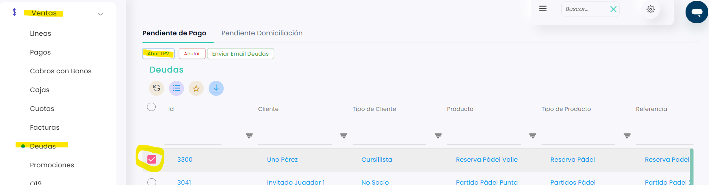
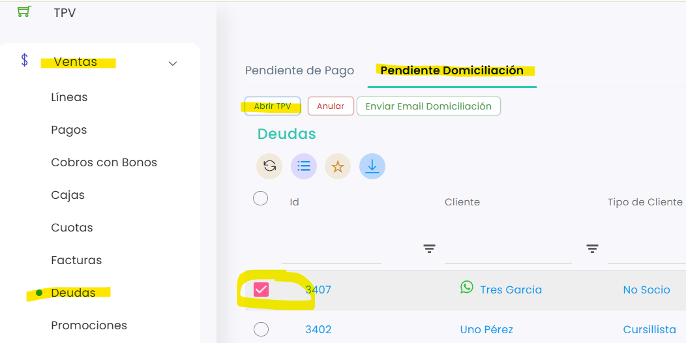
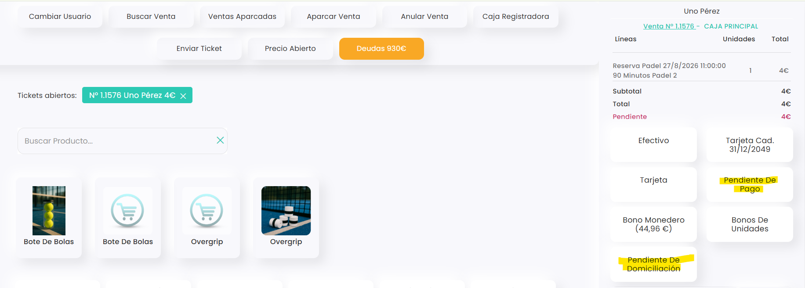
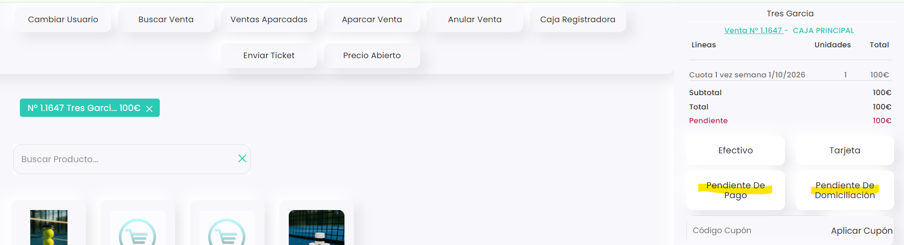

# Cómo pasar una deuda de Pendiente de Pago a Pendiente Domiciliación (y al revés)

Si una deuda que está en **Pendiente de Pago** se va a cobrar por domiciliación bancaria, puedes pasarla a **Pendiente Domiciliación** para incluirla en la próxima remesa. También puedes hacer el cambio al revés. El cambio se hace desde el TPV.

A continuación, se detallan los pasos a seguir:



### Acceso a Deudas

* Dirígete al menú lateral izquierdo y selecciona **Ventas**.
* En el desplegable, elige **Deudas**.
* Entra en la pestaña donde está ahora la deuda: **Pendiente de Pago** o **Pendiente Domiciliación**.



### Abrir la deuda en el TPV

* Marca la casilla de la izquierda de la deuda.
*   Clica en **Abrir TPV**. 

    <figure><figcaption></figcaption></figure>
*   Desde la pestaña **Pendiente Domiciliación** se hace igual: 

    <figure><figcaption></figcaption></figure>



### Cambiar el estado

En la parte derecha del TPV, debajo del total, clica en la opción que corresponda:

*   **Pendiente De Domiciliación**, para pasarla a domiciliación. 

    <figure><figcaption></figcaption></figure>
*   **Pendiente De Pago**, para devolverla a pendiente de pago. 

    <figure><figcaption></figcaption></figure>
* La pantalla parpadea un momento: el cambio ya está hecho.
* Clica en **Salir**, abajo a la derecha, para salir del TPV.



### Comprobar el cambio

* Vuelve a **Ventas › Deudas**.
* La deuda aparece ya en la otra pestaña: en **Pendiente Domiciliación** si la has pasado a domiciliación, o en **Pendiente de Pago** si la has devuelto.



> **Importante:** también puedes hacerlo desde **Ventas › Líneas**: marca la línea, clica en **Abrir TPV** y sigue el paso 3.

Para saber más sobre las deudas de domiciliación, consulta [Deudas pendientes de domiciliación](deudas-pendientes-de-domiciliacion.md).
