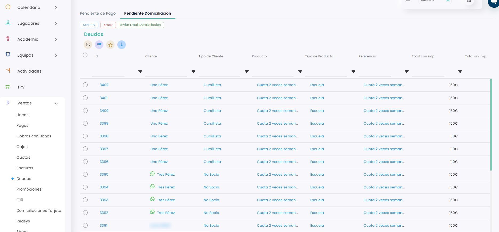

# Deudas pendientes de domiciliación

En **Ventas › Deudas**, la pestaña **Pendiente Domiciliación** muestra las deudas que se cobrarán por domiciliación bancaria. Funciona igual que la pestaña **Pendiente de Pago**: puedes cobrar, anular o avisar al cliente por correo.

A continuación, se detallan los pasos a seguir:



### Acceso a las deudas pendientes de domiciliación

* Dirígete al menú lateral izquierdo y selecciona **Ventas**.
* En el desplegable, elige **Deudas**.
*   Entra en la pestaña **Pendiente Domiciliación**. 

    <figure><figcaption></figcaption></figure>



### Elegir qué hacer

Marca la casilla de la izquierda de las deudas que quieras y clica en el botón que necesites:

* **Abrir TPV:** para cobrarlas. Consulta [Cómo cobrar una deuda](como-cobrar-una-deuda.md).
* **Anular:** para anularlas. Consulta [Cómo anular una deuda](como-anular-una-deuda.md).
* **Enviar Email Domiciliación:** para enviar un correo al cliente. Se envía un correo por cada deuda seleccionada, igual que en [Cómo enviar un email de deudas](como-enviar-un-email-de-deudas.md).



El texto de este correo es la plantilla **Notificación de domiciliación bancaria**, que puedes cambiar desde **Comunicaciones › Plantillas Email**. Consulta [Acceso a plantillas de emails](https://taykus-help-center.gitbook.io/taykushelpcenter/home/comunicaciones/comunicaciones/acceso-a-plantillas-de-emails).
