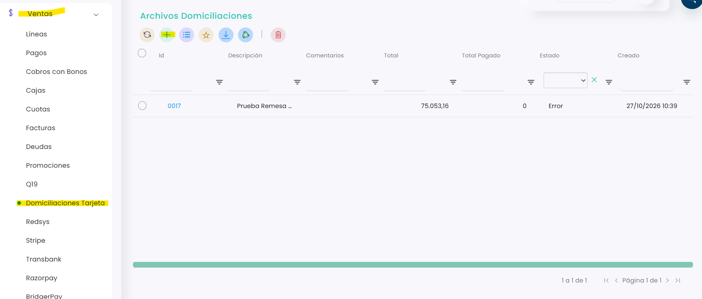
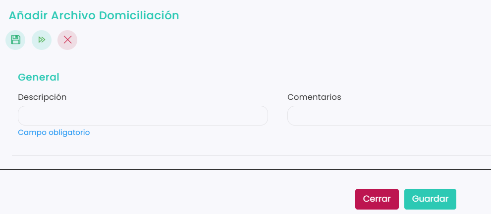
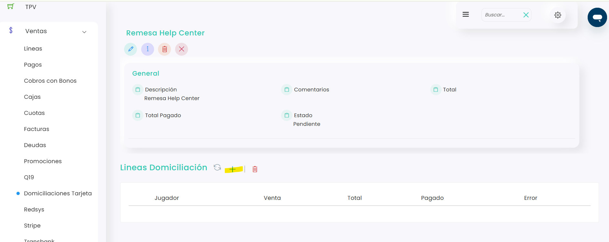
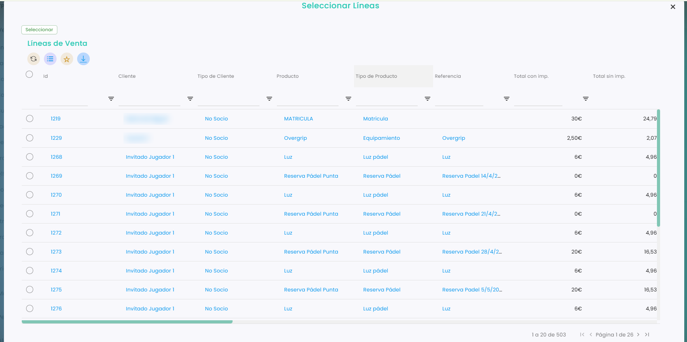
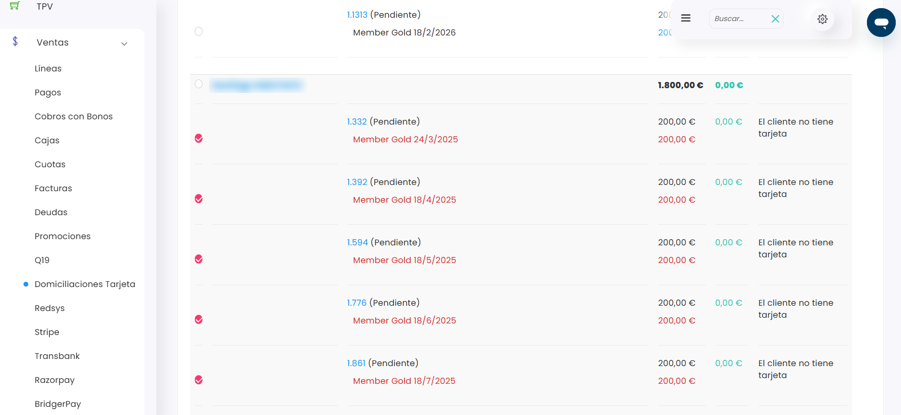
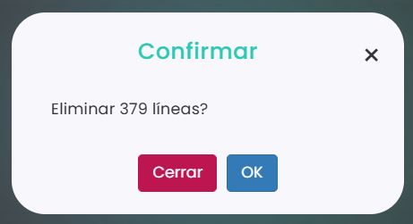
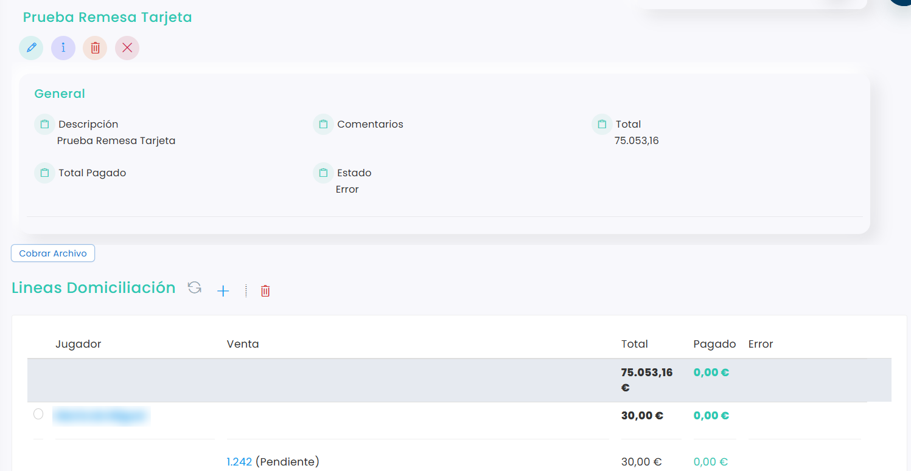
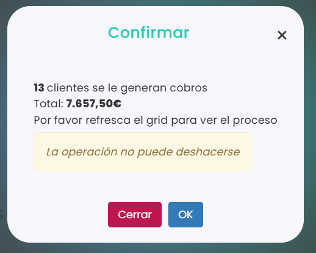
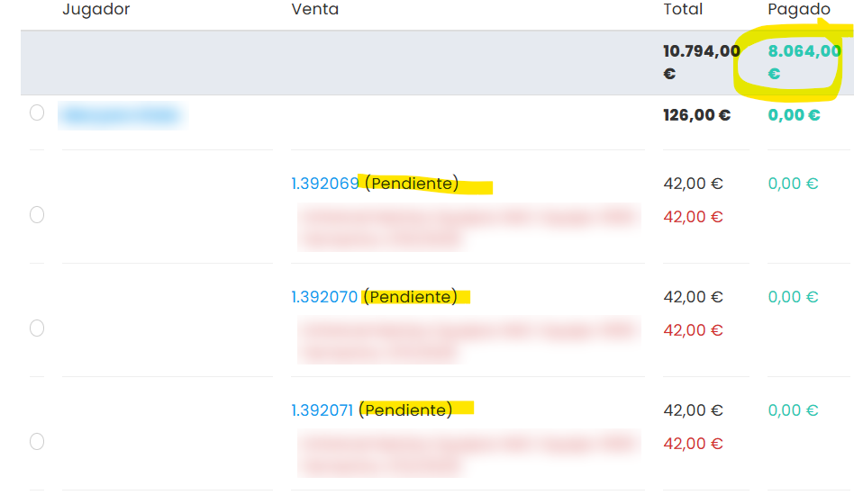

# Cómo hacer una domiciliación con tarjeta

Desde **Ventas › Domiciliaciones Tarjeta** puedes cobrar de golpe todo lo que esté pendiente de pago a los clientes que tienen una tarjeta guardada. Funciona como una remesa del Q19, pero el cobro se hace en la tarjeta en lugar de en la cuenta bancaria.

> **Importante:** no hace falta tener activado el cobro automático con tarjeta en las cuotas. Basta con que el cliente tenga una tarjeta guardada. Para saber cómo la guarda, consulta [Cómo activar el cobro automático con tarjeta](cuotas/como-activar-el-cobro-automatico-con-tarjeta.md).

A continuación, se detallan los pasos a seguir:



### Acceso a Domiciliaciones Tarjeta

* Dirígete al menú lateral izquierdo y selecciona **Ventas**.
*   Haz clic en **Domiciliaciones Tarjeta**. Desde aquí puedes consultar los archivos ya creados o crear uno nuevo. 

    <figure><figcaption></figcaption></figure>



### Crear o abrir un archivo

*   Para crear un archivo nuevo, pulsa el botón **+** y completa los campos:
    * **Descripción**: un nombre que identifique el archivo. Es obligatorio.
    * **Comentarios**: es opcional.

    <figure><figcaption></figcaption></figure>
* Pulsa en **Guardar**.
* Si ya tienes un archivo abierto que todavía no has cobrado, clica en su **Id** para entrar.



### Añadir las líneas

*   Dentro del archivo, en el apartado **Líneas Domiciliación**, pulsa el botón **+**. 

    <figure><figcaption></figcaption></figure>
* Se abrirá la ventana **Seleccionar Líneas**, con todo lo que está pendiente de pago.
* Filtra por las columnas que necesites y desplázate por el listado para encontrar las líneas que quieres cobrar.
*   Marca las líneas y pulsa en **Seleccionar**. 

    <figure><figcaption></figcaption></figure>



### Quitar los clientes sin tarjeta

* Al volver al archivo, verás las líneas agrupadas por jugador.
*   Las de los clientes que no tienen tarjeta guardada aparecen en rojo, con el aviso **El cliente no tiene tarjeta** en la columna **Error**. 

    <figure><figcaption></figcaption></figure>
* Marca esas líneas y elimínalas con el icono de la papelera de **Líneas Domiciliación**.
*   Clica en **OK** para confirmar. 

    <figure><figcaption></figcaption></figure>



### Cobrar el archivo

*   Cuando las líneas sean correctas, pulsa en **Cobrar Archivo**. 

    <figure><figcaption></figcaption></figure>
*   Se abre una ventana con el número de clientes a los que se va a cobrar y el total. Clica en **OK** para lanzar el cobro. 

    <figure><figcaption></figcaption></figure>

> **Importante:** el cobro no se puede deshacer. Revisa bien las líneas antes de confirmar.



### Revisar el resultado

* Pulsa el icono de recargar de **Líneas Domiciliación** para ver cómo avanza el proceso.
*   En la columna **Pagado** verás lo que se ha cobrado. Las líneas que no se han podido cobrar siguen como **(Pendiente)** y, en la columna **Error**, aparece el motivo. 

    <figure><figcaption></figcaption></figure>
* Lo que no se haya podido cobrar se queda como deuda pendiente de pago.



También puedes consultar los cobros en **Ventas › Líneas**, en **Ventas › Pagos** o en la ficha del jugador.
