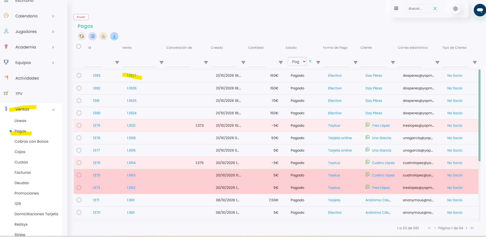

# Cómo emitir una factura desde Ventas > Pagos

Desde **Ventas › Pagos** puedes emitir la factura de una venta a partir de su pago. Se hace igual que desde **Ventas › Líneas**, pero en este listado hay que clicar en el número de la columna **Venta**.

> **Importante:** antes de emitir la factura, revisa que tienes creados los datos de tu empresa en **Configuración › Ventas › Empresas** y, si facturas a empresas, sus datos en **Configuración › Ventas › Empresas clientes**. Para saber cómo, consulta estos artículos:

<a href="https://app.gitbook.com/s/V0h7jTfpeuZY1RmPEtNK/configuracion/ventas/empresas/como-configurar-los-datos-de-empresa" class="button primary">Cómo configurar los datos de empresa</a>

<a href="https://app.gitbook.com/s/V0h7jTfpeuZY1RmPEtNK/configuracion/ventas/empresas-clientes/como-crear-empresas-cliente-en-el-sistema" class="button primary">Cómo crear empresas cliente en el sistema</a>

A continuación, se detallan los pasos a seguir:



### Acceso a Pagos

* Dirígete al menú lateral izquierdo y selecciona **Ventas**.
* En el desplegable, elige **Pagos**.
*   Busca el pago de la venta que quieres facturar. Puedes usar los filtros de cada columna. 

    <figure><figcaption></figcaption></figure>



### Abrir la venta

* Clica en el número de la columna **Venta** (no en el **Id**).
*   Dentro de la venta, clica en **Emitir factura**. 

    <figure><figcaption></figcaption></figure>
* Se abrirá una ventana con los datos de facturación.



### Datos de la factura

En el bloque **Emisor**:

* Selecciona la **empresa emisora** en el campo **Empresa**.
* El sistema rellenará automáticamente los datos asociados, como:
  * Nombre
  * CIF
  * Email
  * Teléfono

<figure><figcaption></figcaption></figure>

En el bloque **Cliente**, puedes elegir entre dos opciones:

**Persona física**

Si la factura es para un particular:

* Deja marcada la opción **Persona física**.
* Revisa o completa los datos del cliente:
  * Nombre completo
  * DNI
  * Email
  * Teléfono
  * Dirección

<figure><figcaption></figcaption></figure>

**Empresa**

Si la factura es para una empresa:

* Marca la opción **Empresa**.
* En el campo **Empresa cliente**, selecciona la empresa correspondiente.
* El sistema completará automáticamente los datos fiscales de esa empresa.

<figure><figcaption></figcaption></figure>




### Guardar

* Revisa los datos y clica en el icono de guardar.
* Se genera la factura de esa venta.



> **Importante:** en **Ventas › Cobros con Bonos** se hace exactamente igual: clica en el número de la columna **Venta** y sigue los mismos pasos.
