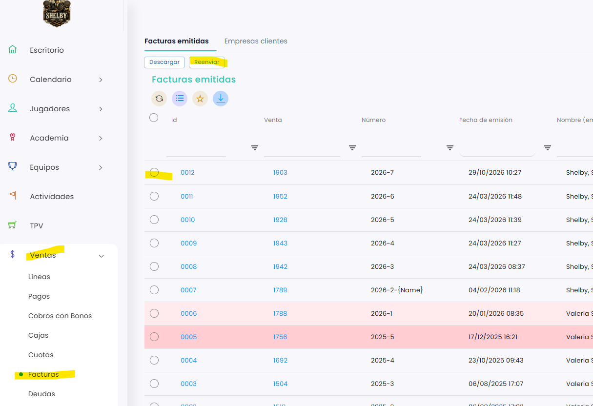

# Cómo reenviar o descargar una factura

Cuando emites una factura, se envía automáticamente al cliente. Si la ha perdido o no le ha llegado, puedes volver a enviársela o descargarla desde **Ventas › Facturas**.

A continuación, se detallan los pasos a seguir:



### Acceso a Facturas

* Dirígete al menú lateral izquierdo y selecciona **Ventas**.
* En el desplegable, elige **Facturas**. Se abre la pestaña **Facturas emitidas**.



### Seleccionar la factura

* Localiza la factura. Puedes usar los filtros de cada columna, por ejemplo **Venta**, **Número** o **Fecha de emisión**.
*   Marca el círculo de la izquierda de la factura.

    <figure><figcaption></figcaption></figure>



### Reenviar o descargar

* Clica en **Reenviar** para volver a enviarla al cliente.
* Clica en **Descargar** para descargarla.


