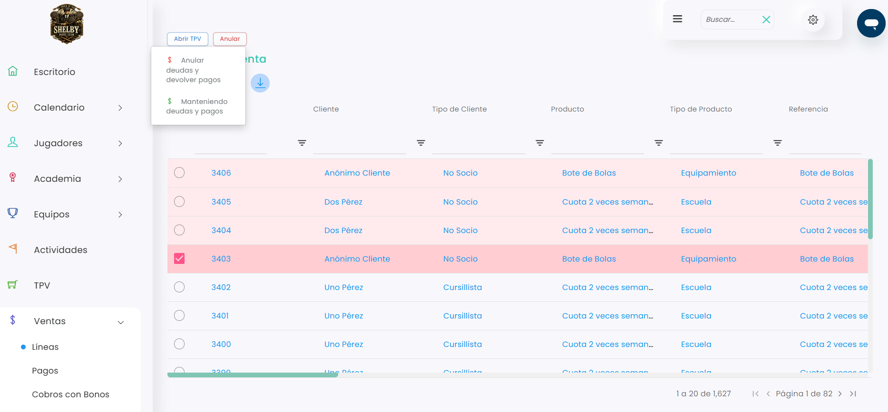
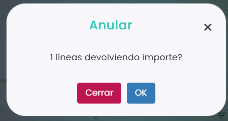

# Cómo anular una venta desde Líneas

Si una venta se ha registrado por error o hay que devolver su importe, puedes anularla desde **Ventas › Líneas**. Puedes anular una sola línea o varias a la vez.

A continuación, se detallan los pasos a seguir:



### Acceso a Líneas

* Dirígete al menú lateral izquierdo y selecciona **Ventas**.
* En el desplegable, elige **Líneas**.



### Seleccionar la línea

* Localiza la venta que quieres anular. Puedes usar los filtros de cada columna, por ejemplo **Cliente**.
* Marca la casilla de la izquierda de la línea. Si quieres anular varias, márcalas todas.
* Clica en **Anular**.



### Elegir la opción de anular

*   Se abre un desplegable. Elige **Anular deudas y devolver pagos**. 

    <figure><figcaption></figcaption></figure>



### Confirmar

*   Se abre una ventana que te pide confirmación: 

    <figure><figcaption></figcaption></figure>
* Clica en **OK** para anularla, o en **Cerrar** si no quieres anularla.



Una vez anulada, verás dos líneas marcadas en color en el listado: en rosa claro, la devolución (con el importe en negativo), y en rosa más oscuro, la venta anulada.

> **Importante:** si al anular hay que devolver un pago en efectivo o con tarjeta, necesitas tener una caja abierta. Si es la devolución de un pago online, no hace falta. Para abrir una caja, consulta [Cómo abrir la caja](../cajas/como-abrir-la-caja.md).

Si lo que quieres anular es una recarga de bono, consulta [Cómo anular una recarga de bono](como-anular-una-recarga-de-bono.md).
