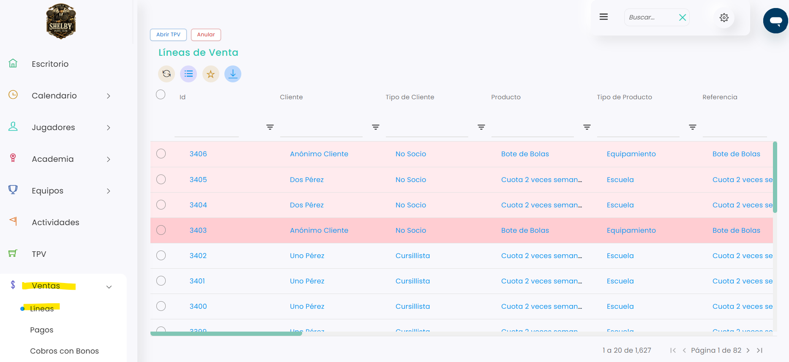
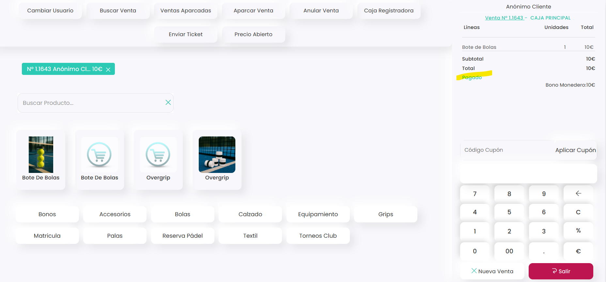

# Cómo cobrar una venta desde Líneas

Desde **Ventas › Líneas** puedes cobrar cualquier venta pendiente: se abre en el TPV y se cobra como una venta normal. Puedes cobrar una sola línea o varias a la vez, aunque sean de clientes distintos. Por ejemplo, cuando un jugador viene a pagar lo suyo y lo de otro.

A continuación, se detallan los pasos a seguir:



### Acceso a Líneas

* Dirígete al menú lateral izquierdo y selecciona **Ventas**.
*   En el desplegable, elige **Líneas**. 

    <figure><figcaption></figcaption></figure>



### Seleccionar las líneas

* Localiza la venta que quieres cobrar. Puedes usar los filtros de cada columna, por ejemplo **Cliente**.
* Marca la casilla de la izquierda de la línea. Si quieres cobrar varias a la vez, márcalas todas.
* Clica en **Abrir TPV**.



### Cobrar en el TPV

* Se abre el TPV con la venta cargada.
* Si has marcado varias líneas, puedes pasar de un ticket a otro desde el TPV, o cargar todas las ventas en el ticket de la derecha para cobrarlas juntas.
* Cobra la venta de la forma habitual.



> **Importante:** necesitas tener una caja abierta para poder cobrar. Consulta [Cómo abrir la caja](../cajas/como-abrir-la-caja.md).

Si marcas una línea que ya está pagada, se abrirá en el TPV con el estado **Pagado** y no habrá nada que cobrar:

<figure><figcaption></figcaption></figure>

Si tienes dudas con el cobro en el TPV, consulta [Cómo hacer una venta](https://taykus-help-center.gitbook.io/taykushelpcenter/home/tpv/tpv/ventas/como-hacer-una-venta).
