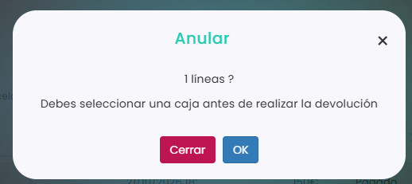

# Pagos

En **Ventas › Pagos** tienes el listado de todos los cobros registrados en el club, con su fecha, cliente, importe y forma de pago.

Desde esta pantalla puedes:

* **Localizar un pago** con los filtros de cada columna.
* **Ver la venta** clicando en el número de la columna **Venta**. Desde ahí también puedes emitir una factura.
* **Anular un pago:** marca su casilla y clica en **Anular**. Se abre una ventana de confirmación. Para poder hacer la devolución, tienes que tener una caja abierta; si tienes más de una, cambia a la que corresponda.
* **Ver las devoluciones:** al anular un pago, aparecen dos líneas marcadas en color: en rosa claro, la devolución (con el importe en negativo), y en rosa más oscuro, el pago anulado.
* **Descargar el listado** con el botón de descarga.

<figure><figcaption></figcaption></figure>

Para emitir una factura, consulta [Cómo emitir una factura desde Ventas > Pagos](facturas/como-emitir-una-factura-desde-ventas-pagos.md). Para abrir una caja, consulta [Cómo abrir la caja](cajas/como-abrir-la-caja.md).
