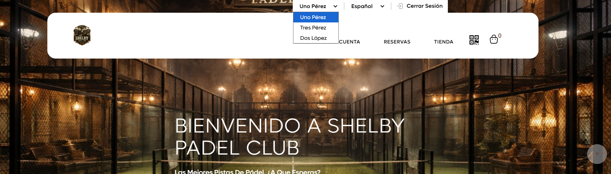
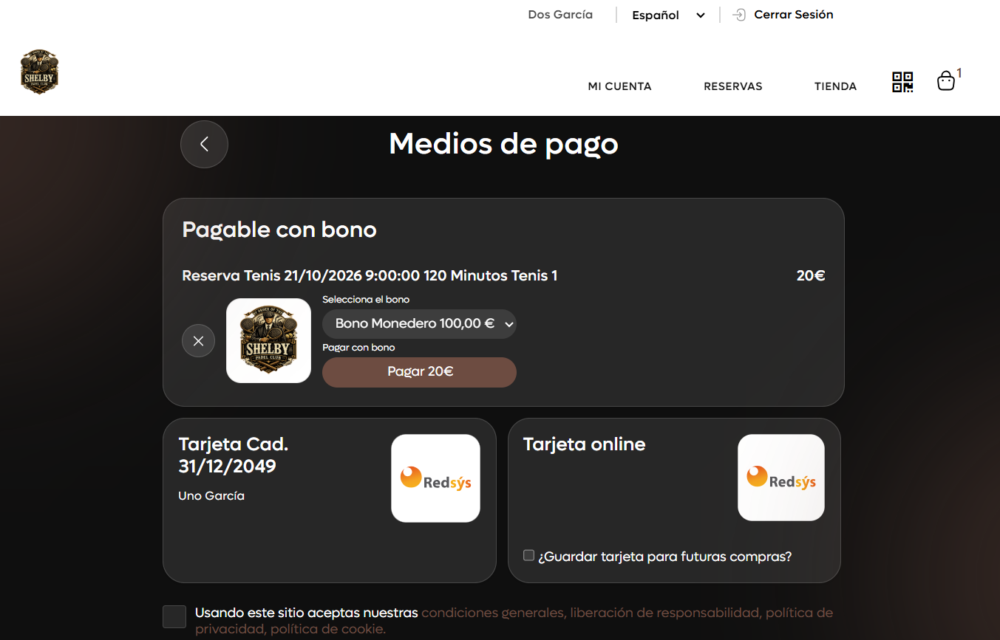
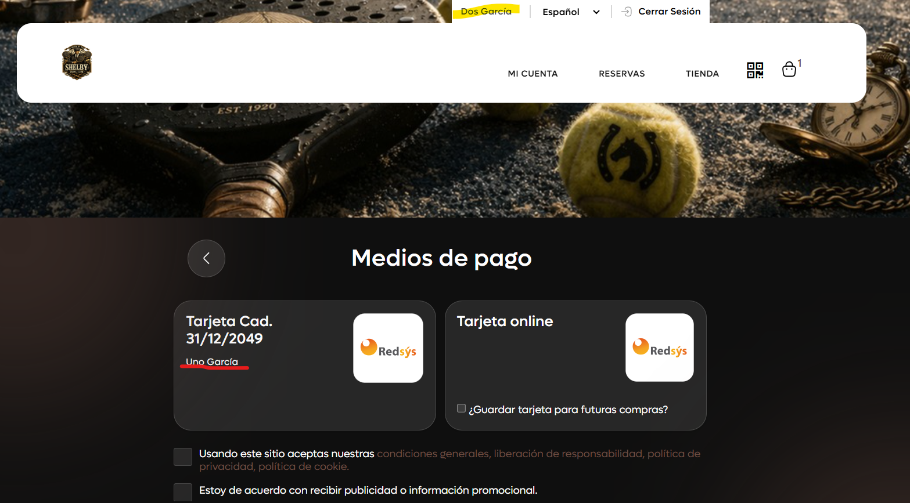

# Cómo cambiar entre tu cuenta y la de tus asociados en la zona de clientes

Si eres el cliente responsable de otras personas (por ejemplo, de tus hijos), puedes gestionar sus cuentas desde la tuya en la zona de clientes de tu club, sin cerrar sesión, y pagar sus reservas y compras con tu bono o tu tarjeta.

A continuación, se detallan los pasos a seguir:



### Iniciar sesión

* Entra en la zona de clientes de tu club con tu usuario y contraseña.



### Cambiar de cuenta

* Clica en tu nombre, en la parte superior de la página.
*   Se abre un desplegable con tu cuenta y las de tus asociados. Selecciona la cuenta que quieres usar.

    <figure><figcaption></figcaption></figure>



### Pagar con tu bono o tu tarjeta

* Desde la cuenta del asociado, reserva o compra como siempre. Al pagar, en **Medios de pago** aparecen tu bono y tu tarjeta guardada.
*   Si tienes un bono, aparece en **Pagable con bono**. Elige el bono en **Selecciona el bono** y clica en **Pagar**.

    <figure><figcaption></figcaption></figure>
*   Tu tarjeta guardada aparece con tu nombre debajo. Selecciónala para pagar con ella.

    <figure><figcaption></figcaption></figure>



> **Importante:** si la persona asociada no tiene un correo propio, solo puede entrar en la zona de clientes desde tu cuenta.
