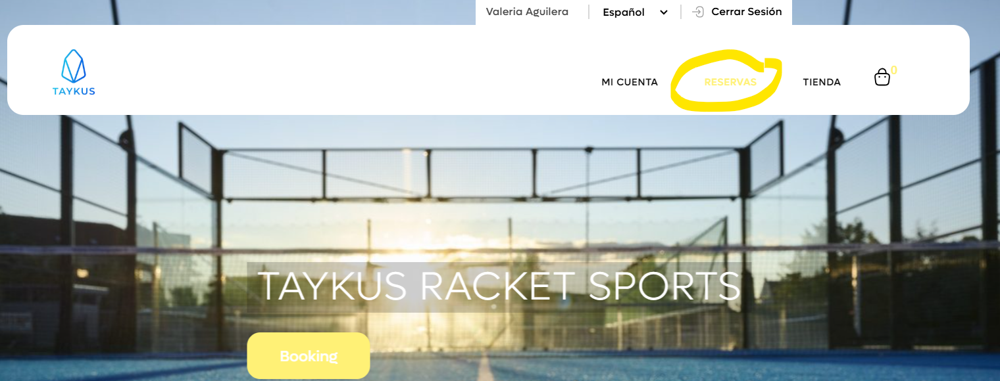
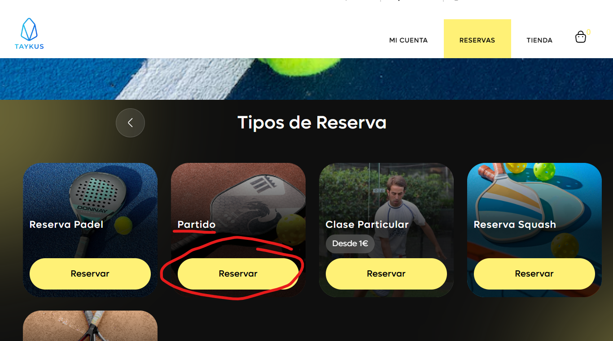
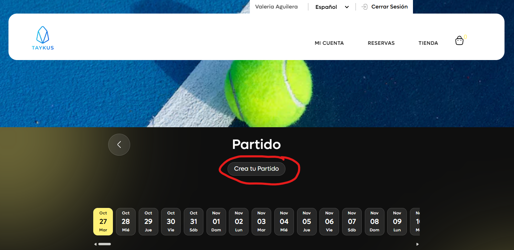
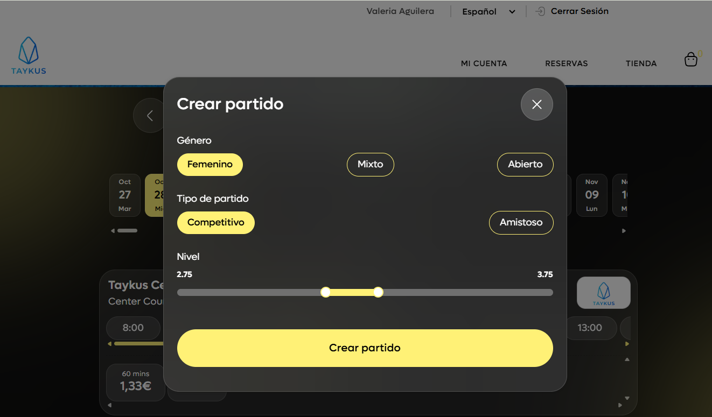
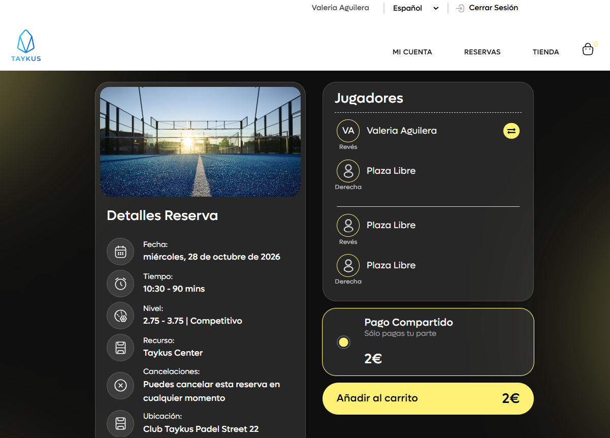

# Cómo crear un partido desde la zona de clientes de tu club

Desde la zona de clientes de tu club puedes crear un partido para que otros jugadores se apunten y completar el grupo, sin necesidad de usar la app.

A continuación, se detallan los pasos a seguir:



### Acceso a Reservas

*   En el menú superior de la web del club, clica en **Reservas**.

    <figure><figcaption></figcaption></figure>



### Elegir Partido

*   En **Tipos de Reserva**, busca **Partido** y clica en **Reservar**.

    <figure><figcaption></figcaption></figure>



### Crear tu partido

* Clica en **Crea tu Partido**.
*   Elige el día y la hora.

    <figure><figcaption></figcaption></figure>

> **Importante:** si no pulsas **Crea tu Partido** y vas cambiando de día, verás los partidos ya creados, a los que te puedes apuntar.



### Datos del partido

<figure><figcaption></figcaption></figure>

* **Género:** te salen **Abierto**, **Mixto** y el de tu género (**Masculino** o **Femenino**).
* **Tipo de partido:** **Competitivo** (el resultado cambia tu nivel) o **Amistoso** (no lo cambia).
* **Nivel:** la barra sale con un rango alrededor de tu nivel. Mueve los dos puntos para elegir el nivel mínimo y máximo de los jugadores que pueden apuntarse.
* Clica en **Crear partido**.



### Pagar tu plaza

* Se abre el resumen del partido, con los **Detalles Reserva** y los **Jugadores**.
* En **Pago Compartido** verás lo que pagas tú: solo tu parte.
*   Clica en **Añadir al carrito** y completa el pago.

    <figure><figcaption></figcaption></figure>



Para saber más sobre cada opción, consulta [Tipos de partido: competitivo, amistoso y género](https://app.gitbook.com/s/hSQoRJmdDmzxYVh7vpFW/calendario/calendario/partidos/tipos-de-partido).
